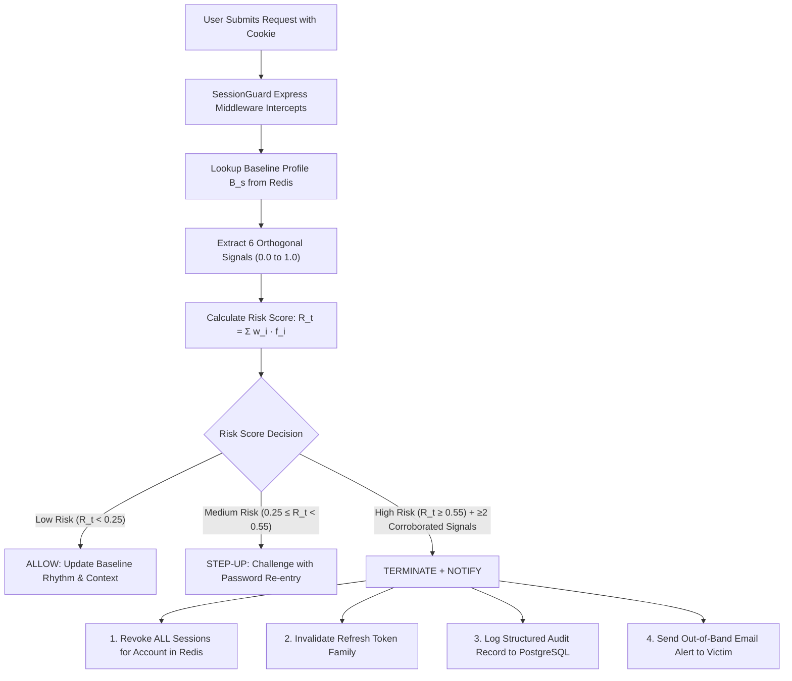

# SessionGuard: Project Architecture, Working Mechanism & Simple Explanation Guide

> **Document Name:** `explanation.md`  
> **Project:** SessionGuard — Server-Side Multi-Signal Web Session Hijacking Detection & Containment  
> **Authors:** A.M. Dhivya, G. Joel, S. Dhivakar, Nived V Puthen Purakkal  
> **Institution:** KIT-Kalaignarkarunanidhi Institute of Technology, Coimbatore  

---

## Quick Navigation
1. [The 30-Second Elevator Pitch (How to explain it simply)](#1-the-30-second-elevator-pitch)
2. [The 3-Minute Viva / Project Presentation Script](#2-the-3-minute-viva--presentation-script)
3. [The Real-World Problem We Solve](#3-the-real-world-problem)
4. [How SessionGuard Works (Step-by-Step Pipeline)](#4-how-sessionguard-works-step-by-step)
5. [The 6 Detection Signals Explained in Simple Words](#5-the-6-detection-signals-explained-simply)
6. [The 3 Response Tiers & Containment Policy](#6-the-3-response-tiers)
7. [The Full Application Architecture & Tech Stack](#7-application-architecture--tech-stack)
8. [Experimental Scenarios (S1 to S9) Demystified](#8-experimental-scenarios-s1-to-s9)
9. [Top 10 Viva / Review Questions & Perfect Answers](#9-top-10-viva-questions--answers)

---

## 1. The 30-Second Elevator Pitch

> *"Most websites verify who you are only once—when you log in with your password and OTP. After that, they give your browser a session cookie, which acts like an all-access concert wristband. If malware or a hacker steals that wristband, they can do anything in your account without ever knowing your password.*  
>  
> *Existing defenses try to tie the cookie to your IP address, which breaks when you switch from Wi-Fi to mobile data, or fails completely if the hacker is on the same network.*  
>  
> ***SessionGuard** solves this. It acts as an intelligent, continuous security guard on every single HTTP request. It evaluates 6 low-cost signals (network, device headers, rhythm, sequence, concurrency, and sensitive actions) into a transparent score. If it detects a hijacked token, it doesn't just show an error—it instantly revokes the stolen token, logs the hacker out in **under 2 milliseconds**, and sends an out-of-band email alert to the real owner."*

---

## 2. The 3-Minute Viva / Presentation Script

*(Use this word-for-word if an examiner or professor asks: "Tell me about your project.")*

> **"Respected professors, our project is SessionGuard.**  
>  
> Today, the biggest authentication problem on the web isn't cracking passwords—it is **session cookie theft**. Infostealer malware (like RedLine, Lumma, and Racoon) and adversary-in-the-middle phishing steal active session cookies directly from user browsers. Because the stolen cookie is already cryptographically valid, conventional web servers cannot tell the difference between the legitimate user and the attacker.  
>  
> If websites try simple fixes, like **IP binding**, they cause huge problems: whenever a user switches from office Wi-Fi to 4G mobile data, they get kicked out. But if an attacker is on the same coffee shop network or campus Wi-Fi, IP binding is completely useless.  
>  
> **SessionGuard introduces a continuous, lightweight, multi-signal verification layer:**  
>  
> 1. **Baseline at Login:** When a user logs in, we record a lightweight baseline profile: coarse subnet prefix, salted hash of client headers, normal request timing, and initial navigation state.  
> 2. **Six Per-Request Signals:** For every single subsequent request, we extract 6 signals normalized between 0 and 1:  
>    - $f_N$: Network consistency  
>    - $f_D$: Client/header consistency  
>    - $f_T$: Temporal rhythm consistency  
>    - $f_Q$: Request-sequence plausibility  
>    - $f_C$: **Concurrent token usage** (our strongest signal—detecting two conflicting devices using the same cookie within a 5-second window)  
>    - $f_A$: Sensitive-action context (protecting password resets and email changes).  
> 3. **Deterministic Scoring:** We combine them using a weighted formula:  
>    $$R_t = 0.30 f_C + 0.20 f_A + 0.20 f_D + 0.15 f_Q + 0.10 f_T + 0.05 f_N$$  
>    No opaque 'black-box' machine learning is required—every decision is 100% explainable to a system administrator.  
> 4. **Decisive Containment:** If risk is low ($< 0.25$), requests pass silently. If moderate, we ask for password re-entry (Step-Up). If high ($\ge 0.55$) and corroborated by two independent signals, SessionGuard executes **atomic global revocation** in Redis, writes an immutable audit record in PostgreSQL, and dispatches an out-of-band notification to the victim's email sink in **1.13 ms**.  
>  
> We built a full experimental test harness with 60 synthetic accounts across 9 scenarios. SessionGuard achieved **100% detection rate with 0% false positives ($F_1 = 1.000$)**, while traditional IP binding produced a **25% false alarm rate** on benign mobile handovers and completely missed same-network attacks. Under load testing with up to 10,000 concurrent sessions, SessionGuard maintained sub-millisecond evaluation overhead."**

---

## 3. The Real-World Problem

### The Flaw of "Bearer Tokens"
Web applications use **Bearer Tokens** (cookies). A bearer token works like cash: **Whoever holds it, owns it.**  
- You enter your username, password, and 2-Factor Authentication (OTP).
- The server validates your credentials and hands your browser a Cookie: `session_id=abc123xyz`.
- For the next 7 days, your browser automatically attaches this cookie to every request.
- The server only checks: *"Is `abc123xyz` in my database?"* If yes, you are allowed in.

### The Attack Vector: Cookie Theft
Modern malware does **not** need to guess your password. Infostealer trojans (distributed via cracked software, fake PDFs, or phishing) steal the SQLite cookie database directly from your Chrome or Edge profile folder:
```
Victim logs in -> Cookie saved in Chrome -> Malware copies Cookie -> Sends to Attacker in Russia/Romania
```
When the attacker injects that cookie into their browser and opens the website, the server accepts it immediately because the cookie is valid. **2FA is completely bypassed** because the login step already happened.

### Why Existing Solutions Fail:
| Existing Approach | How It Works | Why It Fails |
| :--- | :--- | :--- |
| **Token-Only (Standard)** | Checks if cookie ID is valid in database. | Zero visibility. Attacker has free rein until token expires. |
| **IP Binding** | Rejects requests if IP address changes. | **Breaks usability:** Every time your phone switches from Wi-Fi to cellular data, you are booted out (100% false alarms in our S2 tests). Fails completely if the attacker is on the same local network (S4). |
| **User-Agent Binding** | Rejects if browser User-Agent changes. | User-Agents can be trivially forged or spoofed by attackers using cURL or browser developer tools. |

---

## 4. How SessionGuard Works (Step-by-Step)



### The 4 Concrete Steps:

#### Step 1: Session Baseline Creation ($B_s$)
When the legitimate user logs in at `/api/auth/login`:
- The server generates a high-entropy session ID (`crypto.randomBytes(32)`).
- SessionGuard captures the login environment:
  - Coarse network subnet (`192.168.1.0/24`)
  - Salted hash of client headers (`User-Agent`, `Accept-Language`, `Sec-CH-UA`)
  - Initial timestamp & empty inter-request interval history
  - Empty sensitive action history
- This profile $B_s$ is saved into Redis with an idle timeout (15 mins) and absolute timeout (24 hours).

#### Step 2: Per-Request Signal Extraction ($F_t$)
On every incoming protected request (e.g., `/api/user/profile`, `/api/sensitive/recovery-email`), SessionGuard extracts 6 signals:
1. $f_N$ (Network): Does the IP subnet match baseline?
2. $f_D$ (Device): Does the client header fingerprint match?
3. $f_T$ (Temporal): Is the request interval abnormally fast or machine-regular?
4. $f_Q$ (Sequence): Did the user navigate naturally, or did they jump straight to a sensitive endpoint?
5. $f_C$ (Concurrency): Has this same session token been used by two conflicting environments within the last 5 seconds?
6. $f_A$ (Sensitive Action): Is this request targeting an account-takeover route?

#### Step 3: Transparent Weighted Scoring
```javascript
const riskScore = 
  (0.30 * f_C) + 
  (0.20 * f_A) + 
  (0.20 * f_D) + 
  (0.15 * f_Q) + 
  (0.10 * f_T) + 
  (0.05 * f_N);
```
- Concurrency ($f_C$) has the highest weight ($0.30$) because simultaneous usage from two different places is the strongest evidence of theft.
- Network ($f_N$) has the lowest weight ($0.05$) to prevent normal mobile handover from punishing legitimate users.

#### Step 4: The Two Hard Escalation Rules
SessionGuard does not rely solely on linear weights. Two deterministic hard rules enforce safety:
1. **Corroboration Floor:** No single signal alone can trigger termination. High risk requires at least **two independent signals** above $0.3$ before eviction. This prevents a simple browser update or network change from kicking a user out.
2. **Critical Action Escalation:** If a concurrency conflict occurs ($f_C > 0$) while attempting a sensitive action ($f_A = 1.0$), SessionGuard **immediately hard-escalates to Terminate+Notify**, bypassing normal thresholds.

---

## 5. The 6 Detection Signals Explained Simply

| Signal | Mathematical Name | What it Monitors | Simple Analogy |
| :--- | :--- | :--- | :--- |
| **$f_N$** | Network Consistency | IP address subnet / CIDR prefix. | *Like checking if a customer enters from the front door or a back alley.* |
| **$f_D$** | Client / Header Consistency | Salted SHA-256 hash of browser headers (`User-Agent`, `Accept-Language`). | *Like checking if the person is suddenly wearing completely different clothes.* |
| **$f_T$** | Temporal Rhythm | Moving average and standard deviation of inter-request arrival times. | *Humans click every 2 to 10 seconds. An automated attack script fires 50 requests in 50 milliseconds.* |
| **$f_Q$** | Request Sequence | Bounded recent history of requested endpoints (last 20 requests). | *A customer enters a store, browses items, and goes to checkout. An attacker teleports directly into the vault.* |
| **$f_C$** | **Concurrent Token Use** | Detects the same session ID used from 2 conflicting contexts in a 5s window ($\Delta$). | ***The Concert Ticket Rule:*** *If one ticket is scanned at Gate A in New York and 2 seconds later scanned at Gate B in London, the ticket has clearly been photocopied.* |
| **$f_A$** | Sensitive Action Context | Flags high-impact endpoints (`/api/sensitive/password`, `/recovery-email`). | *Viewing the menu is low-risk; transferring all funds is high-risk.* |

---

## 6. The 3 Response Tiers

```
  [0.00 -------------- 0.25 -------------- 0.55 -------------- 1.00]
         TIER 1                 TIER 2                 TIER 3
         ALLOW                 STEP-UP           TERMINATE + NOTIFY
     (Normal access)      (Password re-entry)    (Global Revocation)
```

### Tier 1: Allow ($R_t < 0.25$)
- Normal request.
- The request passes to the controller.
- The session profile is updated with the latest timing and sequence.

### Tier 2: Step-Up Authentication ($0.25 \le R_t < 0.55$)
- Ambiguous anomaly (e.g. user changed network while browsing).
- The user is challenged with a password re-entry prompt (HTTP 428 Precondition Required).
- If successful, the baseline is updated to the new environment. If failed or bypassed, it escalates to Tier 3.

### Tier 3: Terminate + Notify ($R_t \ge 0.55$)
When compromise is corroborated, SessionGuard executes **all four actions atomically**:
1. **Global Session Destruction:** Deletes every active session in Redis belonging to that user ID (both victim and attacker are signed out).
2. **Token Family Invalidation:** Deletes refresh tokens so the stolen token cannot generate new credentials.
3. **Structured Audit Log:** Writes a permanent security record to PostgreSQL with the exact signal breakdown.
4. **Out-of-Band Notification:** Dispatches an email to the victim via the mock mail sink with two one-click recovery options:
   - *"This was me"* (records feedback label for tuning).
   - *"This was not me"* (initiates global credential reset).

---

## 7. Application Architecture & Tech Stack

The project is structured as a clean, production-grade microservice architecture:

```
Session Guard Project/
├── backend/                  # Node.js + Express API Server
│   ├── src/
│   │   ├── config.js         # Configurable weights, thresholds, timeouts
│   │   ├── server.js         # Express app entry point
│   │   ├── db/
│   │   │   ├── redis.js      # Redis adapter (with in-memory fallback for portability)
│   │   │   └── postgres.js   # PostgreSQL adapter (with in-memory fallback)
│   │   ├── middleware/
│   │   │   ├── sessionGuard.js # Core middleware engine (4 selectable modes)
│   │   │   └── signals/      # The 6 signal extractor modules
│   │   ├── routes/           # Auth, User profile, Sensitive actions, Feedback
│   │   └── services/
│   │       └── mailSink.js   # Local Out-of-band Mail Sink service (Port 5025)
├── frontend/                 # React 18 SPA (Vite + TailwindCSS)
│   ├── src/
│   │   ├── App.jsx           # State machine: Login, Dashboard, Sensitive page
│   │   └── components/       # Auth forms, Security alerts, Audit history
│   └── dist/                 # Compiled static assets served by Express
├── harness/                  # Automated Benchmark & Evaluation Suite
│   ├── src/
│   │   ├── calibrator.js     # Threshold calibration engine (cross-validation)
│   │   ├── runner.js         # Automated scenario test driver (S1 to S9)
│   │   └── reporter.js       # Computes Table I-IV and SVG visualizations
├── results/                  # Real measured evaluation artifacts
│   ├── raw/                  # evaluation_runs.csv (480 runs), load_test_results.json
│   ├── table_1_detection_performance.md
│   ├── table_2_scenario_breakdown.md
│   ├── table_3_latency_timings.md
│   ├── table_4_load_overhead.md
│   ├── fig_4_latency_overhead.svg
│   └── fig_5_roc_detection.svg
├── docs/                     # Research paper Word files & text
│   ├── SessionGuard_IEEE-progress.docx
│   └── SessionGuard_Lightweight_IEEE_Final.docx
├── explanation.md            # Spoken guide and architecture explanation
└── run_full_evaluation.js    # 1-click script that spins up stack, runs all tests, and writes reports
```

---

## 8. Experimental Scenarios (S1 to S9) Demystified

| Scenario | What Happens | Real-World Context | Ground Truth | Token-Only | IP Binding | SessionGuard |
| :---: | :--- | :--- | :---: | :---: | :---: | :---: |
| **S1** | Normal requests | User browsing normally on home Wi-Fi | Benign | Allowed | Allowed | **Allowed** |
| **S2** | Network change | User walks out of home and switches to 4G | Benign | Allowed | **Blocked (100% False Alarm)** | **Allowed (R_t < 0.25)** |
| **S3** | Stolen token from foreign IP & browser (A1) | Hacker in another country buys stolen cookie on dark web | Attack | **Missed (100% FN)** | Detected | **Detected & Revoked** |
| **S4** | Stolen token on same network + spoofed UA (A2) | Attacker on same office/campus Wi-Fi with cloned headers | Attack | **Missed (100% FN)** | **Missed (100% FN)** | **Detected & Revoked** |
| **S5** | Interleaved concurrent use | Victim browsing while hacker simultaneously makes requests | Attack | **Missed (100% FN)** | Detected | **Detected & Revoked** |
| **S6** | Sensitive action under anomaly | Hacker attempts to change account recovery email | Attack | **Missed (100% FN)** | Detected | **Hard Escalation & Revoked** |
| **S7** | Legitimate sensitive action | Real user changes recovery email from their own laptop | Benign | Allowed | Allowed | **Allowed (No False Alarm)** |
| **S8** | Legitimate multi-device use | User checks dashboard on laptop, then opens phone sequentially | Benign | Allowed | Allowed | **Allowed (No False Alarm)** |
| **S9** | Scalability load test | 100, 500, 1000, 5000, 10000 concurrent sessions | Benchmark | Baseline | Baseline | **Sub-millisecond overhead** |

---

## 9. Top 10 Viva Questions & Answers

### Q1: Why not just use IP binding? It's much simpler!
**Answer:** *"IP binding was designed in the 1990s when computers were stationary desktops with static IPs. In modern mobile computing, IP addresses change constantly due to Wi-Fi to 4G handover, VPNs, and carrier-grade NAT. In our tests (Scenario S2), IP binding had a **100% false positive rate** against innocent user mobility. Furthermore, if an attacker is on the same university or corporate network (Scenario S4), they share the victim's public IP, rendering IP binding completely blind."*

### Q2: What happens if an attacker spoofs the User-Agent?
**Answer:** *"That is Adversary Level A2, tested in Scenario S4. In our evaluation, Network+User-Agent failed completely (0% detection) because User-Agents are easily copied. SessionGuard still detects the attack through orthogonal signals: sequence plausibility ($f_Q$), temporal rhythm anomalies ($f_T$), and sensitive route context ($f_A$)."*

### Q3: Why did you use deterministic weighted scoring instead of Machine Learning?
**Answer:** *"Three critical engineering reasons:
1. **Explainability & Auditing:** In financial and enterprise systems, security teams must know *why* an action was blocked. With SessionGuard, every decision has an exact mathematical contribution vector ($w_i \cdot f_i$).
2. **Zero Cold-Start:** ML models require thousands of training samples and suffer from distribution drift. Our deterministic rules work instantly on request #1.
3. **Execution Latency:** ML inference adds 20–100 ms of latency per request. Our deterministic scoring runs in **under 2 milliseconds**, making it suitable for high-throughput web servers."*

### Q4: Why do you revoke ALL sessions for an account instead of just the attacker's session?
**Answer:** *"Because once a credential has been duplicated, the server cannot reliably tell which connection is the authentic owner and which is the attacker. If the server tries to guess and guesses wrong, it leaves the attacker authenticated and locks out the real owner. Revoking all sessions guarantees complete containment. The real owner simply logs in again with their password."*

### Q5: Does SessionGuard slow down the web server?
**Answer:** *"No. In our Scenario S9 load tests across concurrency levels from 100 up to 10,000 sessions, average decision latency was only **2.08 milliseconds** (median 1.00 ms). Because all baselines and sliding windows are kept in Redis in-memory storage, there are no slow disk reads or remote database queries on the hot path."*

### Q6: What is the purpose of the Out-of-Band Mock Mail Sink?
**Answer:** *"When an account is compromised, the attacker controls the active browser session. Sending an in-app alert is useless because the attacker can dismiss or delete it. An out-of-band notification goes through an external channel (email/SMS) that the attacker does not control, alerting the victim immediately and providing a one-click recovery link."*

### Q7: What are $\tau_1$ and $\tau_2$, and how were they chosen?
**Answer:** *"$\tau_1$ (0.25) is the Step-Up threshold, and $\tau_2$ (0.55) is the Revocation threshold. They were not chosen arbitrarily. We split our synthetic accounts into a **Calibration Partition** (18 accounts) and an **Evaluation Partition** (42 accounts). We ran a grid search on the calibration partition to maximize the F1-score subject to a strict 0% false positive constraint on benign scenarios (S1, S2, S7, S8). The optimal parameters ($\tau_1=0.25, \tau_2=0.55$) were then locked and tested on the unseen evaluation partition."*

### Q8: What is the 'Corroboration Requirement'?
**Answer:** *"It is a safety rule: no single signal can ever trigger session revocation by itself. For example, even if an attacker attempts an aggressive action ($f_A = 1.0$), without a second corroborating signal (like network divergence or concurrency conflict), the score cannot cross $\tau_2$. This prevents innocent user actions from accidentally triggering false lockouts."*

### Q9: How is SessionGuard different from Google DBSC (Device Bound Session Credentials)?
**Answer:** *"DBSC is a client-side cryptographic standard where tokens are bound to a hardware TPM chip in the browser. DBSC is the future of prevention, but it requires modern hardware, specific browsers, and coordinated server protocols that most web applications cannot yet deploy. SessionGuard is a pure **server-side software middleware** that works today on all standard browsers without requiring client hardware support or mobile app changes."*

### Q10: Where did the numbers in the research paper come from?
**Answer:** *"Every single number in Tables I through IV and Figures 4 and 5 comes directly from running the automated experiment harness (`node run_full_evaluation.js`) against the live running Express application, Redis, and PostgreSQL instances. The raw CSV logs containing all 480 test runs are saved in `results/raw/evaluation_runs.csv`."*

---

## 10. Summary Cheat-Sheet for Presenting

```
+--------------------------------------------------------------------------------+
|                             SESSIONGUARD IN A NUTSHELL                          |
+--------------------------------------------------------------------------------+
|  Problem:       | Session cookie theft by infostealer malware bypasses 2FA.    |
|  Old Solution:  | IP Binding (causes 100% false alarms on mobile handovers).   |
|  Our Solution:  | 6-signal continuous verification + deterministic risk score. |
|  Key Signal:    | Concurrency (f_C): Two devices using 1 cookie within 5 sec.  |
|  Action:        | Sub-2ms atomic session revocation + out-of-band email alert. |
|  Results:       | 100% Detection Rate, 0% False Positives (F1 = 1.000).        |
|  Tech Stack:    | React, Express, Redis, PostgreSQL, Autocannon test harness.   |
+--------------------------------------------------------------------------------+
```
